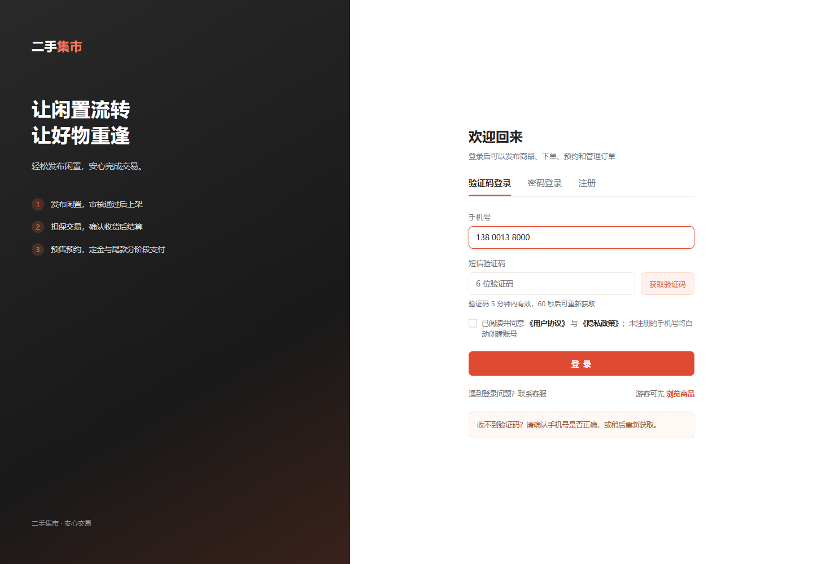
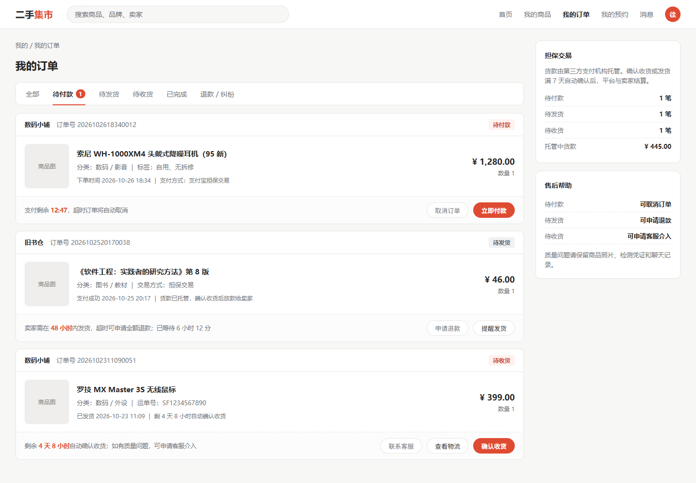

# 实验二：软件设计与建模

**项目**：项目 2 · 二手交易系统  
**学号 / 姓名**：241220026 / 徐浩然  

## 一、项目说明

本项目是面向校园个人买家与卖家的网页端二手交易系统，覆盖商品发布、审核、检索、下单、支付、履约、退款、评价与统计，管理员负责商品审核和违规处置。

系统支持直售与预售，支付由支付宝/微信担保托管，平台不存储现金。商品包含 11 个状态、25 条允许转换；支持退款，不支持七天无理由退货。

## 二、主要功能

系统按业务对象划分为 7 个模块。模块通过拥有者提供的接口协作，不直接修改其他模块的数据或状态。

| 模块 | 主要职责 | 拥有的数据或状态 |
|---|---|---|
| **M1 账号与权限** | 注册登录、统一买家/卖家账号、会话与权限校验 | 用户、会话与权限规则 |
| **M2 商品中心** | 商品草稿、审核、修改重审、上下架、违规处置与检索 | 商品、图片、分类、审核记录及商品状态机 |
| **M3 预售预约** | 创建预约并锁货、定金支付、卖家确认、到货、取消与失效 | 预约记录及预约状态机 |
| **M4 交易与资金** | 下单、支付、订单履约、托管、退款、结算与手续费 | 订单、支付单、托管流水、退款单及订单状态机 |
| **M5 沟通与纠纷** | 商品咨询、消息、纠纷识别、客服介入与工单 | 会话、消息与纠纷工单 |
| **M6 评价与统计** | 双方互评、自动好评、评价申诉与卖家统计 | 评价与统计结果 |
| **M7 日志与运维** | 关键操作留痕、组合查询、每日备份与恢复 | 操作日志与备份记录 |

## 三、软件架构

### 3.1 分层与部署

浏览器经 API 网关访问 M1～M7，再经数据访问层进入 MySQL。一期采用模块化单体和共享数据库，各模块可分别开发测试，但不作为七个独立服务部署；跨模块状态变化必须经过模块接口。外部依赖为支付宝/微信、对象存储、短信通知和定时调度。

### 3.2 关键模块交互

1. **M3 ↔ M4**：M3 判断预约规则并发起定金、尾款或退定金；M4 执行资金动作并返回结果。
2. **M4 → M2**：创建订单时锁货，支付后转交易中，完成后转已售出，取消或未发货退款后恢复原销售状态；M2 校验并执行商品状态转换。
3. **M5 → M2 / M4**：M5 管理会话与工单，商品和订单仍分别由 M2、M4 修改。
4. **M4 → M6，M1～M6 → M7**：订单完成后提供评价与统计事实，关键操作统一留痕。

### 3.3 两条购买主流程

**普通商品**：M4 创建“待付款”订单时，由 M2 原子锁为“待付款锁定”，同一商品最多一条有效订单；支付成功后订单转“待发货”、商品转“交易中”；取消或 15 分钟超时则放货，迟到款项原路退回，订单不恢复。

**预售商品**：M3 创建“待付定金”预约并立即锁货；定金成功后由卖家确认预约、确认到货，买家再付尾款；尾款成功后 M4 才生成订单并保存来源预约号，商品转“交易中”。后续发货、收货与退款复用普通订单流程，但自动确认时点不同：普通订单发货满 7 天自动确认；预售订单在卖家确认到货并发送提示后，从下一天 00:00 起满 1 个完整日自动确认。

**预约与支付单不是同一个概念。** 预约记录交易意向与履约过程，提交后即有预约号；支付单记录一次具体付款，定金与尾款分别形成支付单。尾款成功后，订单通过来源预约号串联定金与尾款，退款则关联原支付单。

有效预约或待付款锁定期内，商品从公开搜索和列表隐藏，仅相关买卖双方可从预约或订单进入；取消、拒绝或过期后恢复公开。卖家确认后取消或尾款逾期即使不退定金，也必须放货。

### 3.4 设计原因

1. **按业务对象划分**：避免按页面拆分造成同一状态判断散落多处。
2. **状态所有权单一**：商品、预约、订单分别只由 M2、M3、M4 修改，避免状态机漂移。
3. **预约、订单与商品解耦**：预约规则、资金单据和商品可售状态可分别检查与测试。

### 3.5 组件图

> 图 1 组件图。前端经 API 网关进入同一后端应用；M4 连接支付机构，M2 连接对象存储，定时调度只触发任务，具体业务仍由 M3/M4/M6/M7 处理。

API 网关是统一入口，负责请求路由、登录校验和权限前置检查，不直接修改商品或订单。M1～M7 位于同一后端应用内，通过模块接口协作；数据访问层负责持久化，但每项业务数据只能由拥有它的模块写入。这样既保留清晰的模块边界，又避免一期引入微服务通信和分布式事务的额外成本。

外部组件按职责隔离：支付机构只负责付款、退款及结果回调，对象存储只保存商品图片，短信只承载通知。定时调度到点发出触发信号，例如 M3 的预约/尾款超时、M4 的待付款取消与自动确认、M6 的自动好评、M7 的每日备份；具体状态判断仍回到业务模块，避免把业务规则写进调度器。

## 四、UML 设计图

完整提交包含 11 组 PlantUML 源文件与 PNG。正文保留组件图、类图、状态图和时序图四种核心类型，其余用例图、异常状态图、订单状态图及活动图见提交包。

### 4.1 类图

> 图 2 类图（一）。表达用户、商品、预约与日志的发布链：商品包含图片、分类、标签和审核记录；商品保留多条历史预约，但同时最多一条有效预约。

类图（一）共 8 个类，各类作用如下：

- **用户 User**：保存账号身份、角色和账号状态，是注册登录与权限校验的入口。普通用户同时可以作为买家和卖家，管理员、客服则通过角色获得后台权限。
- **商品 Product**：保存标题、价格和销售状态，是商品发布的核心对象。提交审核、修改、下架和可见性判断集中在这里，保证商品状态转换只有一个业务入口。
- **商品图片 ProductImage**：保存一张图片的存储地址和展示顺序。一个商品有多张有序图片，因此独立为一对多关系。
- **分类 Category**：提供稳定的分类维度，一个分类可包含多个商品，用于浏览、筛选和统计。
- **标签 Tag**：描述“自用”“无拆修”等灵活特征，与商品是多对多关系；它补充分类不能表达的检索信息，但不参与商品状态判断。
- **审核记录 AuditRecord**：保存每次审核的结论、审核人、驳回理由和时间。商品可以经历多次提交和审核，所以保留多条历史记录。
- **预约 Reservation**：保存预售的定金、尾款、有效期、各阶段时间和预约状态，并提供有效预约、定金是否可退等判断。商品可保留多条历史预约，但同时最多一条有效预约。
- **操作日志 OperationLog**：记录操作人、操作类型、对象、结果和时间，用于追踪关键变更及失败原因。它与业务对象关联，但不参与业务状态修改，避免把审计信息混入商品或预约数据。

> 图 3 类图（二）。表达交易与资金链：预约记录履约过程，支付单记录一次具体付款；预售订单保存来源预约号，退款单关联原支付单，结算记录保存成交额、手续费与卖家实收。

类图（二）包含 9 个交易与服务类，并引用类图（一）的 Reservation，不重复建立另一套预约定义：

- **订单 Order**：保存成交金额、手续费、履约状态和发货/收货时间，是支付后履约过程的核心。普通订单的来源预约号为空，预售订单通过该字段关联原预约，使两种购买方式复用同一套发货、收货与结算逻辑。
- **支付单 Payment**：记录一次具体付款的业务对象、款项类型、支付通道、第三方流水和支付状态。普通货款、定金和尾款都是支付单，但预约或订单本身不是支付单，这样能把业务进度与资金结果分别追踪。
- **托管流水 EscrowRecord**：记录资金冻结、放款和退款的时间、类型与金额。一张支付单可产生多条流水，用于还原“钱何时托管、何时放出或退回”，也便于对账。
- **退款单 Refund**：关联原支付单并保存退款金额、原因和处理状态。退款有独立处理过程，不能仅靠修改支付单状态表达；迟到支付退款和退定金也能沿原支付单追溯。
- **结算记录 Settlement**：在订单完成后保存成交额、手续费、卖家实收和结算时间。一笔订单最多结算一次，避免重复放款，并将资金结算结果与订单履约状态分开保存。
- **评价 Review**：保存一方提交的评分、文字、自动好评标记和修改期限。一笔订单的买家与卖家各产生一条评价，同一方重复提交按修改处理，以支持双方互评和 14 天评价规则。
- **纠纷工单 DisputeTicket**：保存处理人、处理说明、状态与创建时间。它记录客服的裁定过程；订单是否转纠纷中、退款或下架仍由 M4、M2 执行，避免客服直接改写业务数据。
- **会话 Conversation**：把同一商品或订单相关的沟通组织起来，作为消息和纠纷处理的上下文。
- **消息 Message**：保存会话中的一条文字或图片内容及发送时间。一个会话中可以包含多条消息。
- **Reservation（跨图引用）**：只提供预约编号，用于连接定金、尾款、退定金和尾款成功后的订单。

资金设计采用“业务单 → 支付单 → 托管流水”的链路，退款单再回指原支付单，订单完成后才产生结算记录。这样订单金额只表示本次成交额，实际付款、退款与放款都有独立凭证，能够解释预售两次付款和异常退款，而不会把多笔资金记录压缩成订单上的一个“已支付”标记。

### 4.2 商品状态图

> 图 4 商品状态图（一）成交主线。普通商品创建订单即锁货，支付后进入交易中；预售商品在尾款成功后进入交易中。取消或超时放货，未发货退款恢复原销售状态，确认收货后转为已售出。完整异常与退出转换见提交包中的状态图（二）。

普通商品包含“待付款锁定”状态，这个状态为：创建订单时先独占商品，取消或 15 分钟超时再回到已发布，避免多个买家同时支付抢购一件商品。预售商品不增加“待定金锁定”状态，而是在已预售状态下用有效预约表达独占，避免重复维护两套等价状态。

两种商品进入交易中后共用履约路径。未发货全额退款要恢复原来的销售状态，所以普通商品回到已发布、预售商品回到已预售；已发货后由客服或管理员裁定终止的商品才进入已下架。

### 4.3 普通商品时序图

> 图 5 普通商品创建订单、支付与取消。M4 请求 M2 原子校验并锁货，锁货成功才创建待付款订单；支付与取消/超时只允许一个结果先生效，迟到支付只退款、不恢复订单。

图中买家、M4、M2 和支付机构分别代表用户动作、交易协调、商品状态管理和外部资金结果。M4 不自行修改商品，而是先请求 M2 原子校验并锁货，成功后才创建待付款订单，因此“有订单”和“商品被锁住”不会分成两个不一致的结果。

支付回调仍需检查订单当前状态：若订单仍待付款，M4 才通知 M2 转交易中；若取消或超时已先生效，订单保持已取消，实际到账款项原路退回。

### 4.4 预售商品时序图

> 图 6 预售预约、定金、尾款与订单生成。M3 负责预约与确认，M4 分别处理定金和尾款支付单，尾款成功后才生成待发货订单；预约关闭时放货，定金是否退还需按确认前后区分。

预售把 M3 和 M4 分开：M3 判断预约是否有效、推进卖家确认与到货，M4 只负责定金、尾款支付单和资金回调。提交预约就生成预约号并锁货，但此时还没有订单；只有尾款成功后才创建待发货订单，并以来源预约号串联两次付款。这样既能追踪预售履约，也能复用普通订单的后续流程。

关闭预约时必须同时考虑放货和定金：确认前取消、卖家拒绝或确认超时，退定金并恢复已预售；卖家确认后买家取消或尾款逾期，定金不退但仍须放货。

## 五、UI 界面设计

以下 8 张界面设计示意图覆盖全部 7 个模块，使用 HTML/CSS 制作并由浏览器导出。数据为静态演示内容，按钮仅表达可操作性，目前未接后端。界面设计遵循“先展示当前状态，再提供该状态下允许的操作”，把业务规则落实为可见信息和按钮，而不是在页面上堆放需求说明。

### 5.1 登录 / 注册（M1）

> 图 7 登录 / 注册页。游客可浏览商品；登录与注册使用统一账号，登录后可发布、购买、预约和沟通。

图中右侧提供验证码登录、密码登录和注册入口，当前示例展示手机号、短信验证码、获取按钮及用户协议确认；验证码有效期和重新获取时间直接放在输入区附近，便于用户处理登录失败。左侧用三步简要说明发布、担保交易和预售预约，让新用户在注册前理解平台用途。

登录后仍使用同一个账号进行买卖，不设置两套身份。游客入口只承担浏览商品的引导，发布、预约、下单和沟通等需要身份与权限的操作在登录后开放。

### 5.2 我的商品（M2，卖家）

> 图 8 我的商品页。卖家按状态筛选商品，进行发布、编辑、下架和查看审核结果；待付款锁定商品可查看或取消关联订单。

顶部汇总商品数量和公开售卖数量，状态标签覆盖草稿、审核、销售、交易和退出状态。表格逐行展示商品、当前状态、价格、浏览量和最近更新时间，卖家不用进入详情就能判断商品处于哪个环节，再通过“发布闲置”或批量下架完成管理动作。

操作列随状态变化：待审核商品可撤回，已驳回商品直接显示驳回理由并提供“修改并重提”，待付款锁定商品提供订单入口和取消订单，存在有效预约或正在交易的商品禁用编辑、下架。这样把状态机约束转化为界面操作，避免卖家在商品已被占用时改价或重复出售。

### 5.3 商品详情（M2，买家）

> 图 9 商品详情页。买家查看商品与预售信息，可咨询卖家、提交预约并支付定金；页面同时展示定金、尾款和取消规则。

左侧主图与缩略图用于查看商品成色，右侧集中展示标题、分类标签、售价、定金、尾款、预约有效期和发货地。卖家卡片提供实名、成交和退款信息，并可进入并联系卖家，帮助买家在预约前判断商品和交易对象是否可信。

“预售购买流程”把提交预约、支付定金和支付尾款按顺序列出，主按钮只突出“立即预约”，收藏和举报作为次要操作。预约须知放在按钮附近，明确卖家确认前后的定金退款差异，避免买家付款后才发现规则。

### 5.4 预约管理（M3）

> 图 10 预约管理页。卖家处理预约确认、拒绝和到货确认，并查看定金、尾款进度；预约卡保留关联订单入口。

页面用状态标签筛选预约，卡片分别演示待确认、已确认待到货和已完成三种情形。每张卡都保留买家、预约号、商品、定金、尾款和时间信息，使卖家能核对“当前是谁的预约、收到多少钱、下一步该做什么”。

待确认卡提供确认预约或拒绝并退定金，待到货卡提供确认到货并提示尾款窗口，已完成卡显示关联订单和手续费，可继续查看订单。右侧汇总定金退款规则，与按钮旁的即时提示互相补充。

### 5.5 我的订单（M4）

> 图 11 我的订单页。买家按订单状态付款、查看履约或申请退款；侧栏展示担保交易和售后入口。

我的订单页面中包括了不同状态的订单，每种订单有自己的状态，例如待付款订单显示 15 分钟支付倒计时，可取消或立即付款；待发货订单显示 48 小时发货要求，可提醒发货或申请退款；待收货订单显示运单和自动确认时间，可查看物流、确认收货或联系客服。订单号、商品、金额和支付方式保持在同一卡片内，便于用户查看核对。

右侧可以列出部分总结性或者提示性卡片，例如“售后帮助”按状态给出入口。

### 5.6 卖家数据统计（M6）

> 图 12 卖家统计页。卖家按时间查看成交笔数、成交金额、在架数和退款率，以及分类占比与商品明细。

顶部可在近 30 天、近 7 天和本月之间切换统计区间。四张指标卡先给出成交笔数、成交金额、在架商品和退款率，并补充上期变化、手续费及退款笔数，让卖家先掌握整体经营结果。

中部柱状图展示近 7 日成交变化，右侧按商品分类展示成交构成，下方表格再列出具体商品、成交时间、金额和手续费。统计图明确只计入已完成订单，排除已取消、已退款及纠纷中订单。

### 5.7 关键操作日志（M7）

> 图 13 关键操作日志页。管理员与客服按操作、对象、结果和时间组合查询；日志只读，失败操作及原因同样留痕。

这张图为管理员视角，可以看到数据库对应的UI界面。后台左侧按内容交易、运营审计和系统管理组织入口，当前页标明只读权限，并允许导出当前查询。查询区可按操作类型、目标类型、结果、时间、操作人、订单号和目标 ID 组合筛选，用于从大量记录中定位一次具体业务操作。

结果表展示时间、操作人及角色、目标、关联订单、关键变更、结果和 IP/端。例如下单记录能看到商品由已发布转为待付款锁定，取消失败记录能看到失败原因是订单已支付。

### 5.8 沟通与纠纷（M5）

> 图 14 商品咨询与纠纷页。买卖双方围绕商品沟通，发生争议时可申请客服介入；右侧展示工单进度与处理须知。

## 六、AI 辅助使用记录

本实验采用“人负责业务决策、检查校对与最终确认”的工作流：先由人确定业务口径，再让 AI 生成图稿或文字；随后对照需求检查状态、迁移、分支和界面功能，实际渲染检查线路、文字与分页；发现问题后由人修改或指导修正，并用独立 Git 提交保存人工复核结果。

| 序号  | 使用场景与输出                                             | 人工检查与修改                                     | 可总结的经验                    |
| --- | --------------------------------------------------- | ------------------------------------------- | ------------------------- |
| 1   | 使用 DeepSeek V4.1 Flash 根据 lab01 需求生成用例图 PlantUML 初稿 | 初稿遗漏游客身份与权限，人工核对后补充                         | 参与者与权限必须回查原始需求            |
| 2   | 使用 DeepSeek V4.1 Flash 根据商品状态机生成商品状态图               | 逐条比对 25 条允许转换，发现单图线路复杂                      | 容易多画或少画边，复杂图需人工调整         |
| 3   | 使用 DeepSeek V4.1 Flash 提供多种组件图排版方案                  | 对比后决定把跨模块调用写入图注，减少箭头                        | AI 排版判断需结合实际效果            |
| 4   | 使用 DeepSeek V4.1 Flash 重新组织商品状态机并给出拆图方案             | 按成交主线与异常退出拆成两张图                             | 复杂状态图需要人主动拆分              |
| 5   | 调整锁货口径，指导 DeepSeek V4.1 Flash 简化订单状态图和支付时序图         | 删除注释虚线、SQL 与事务细节；修正不可下单分支错误流入支付的问题，并调整布局与字号 | 抽象层级、分支正确性和文字密度必须人工检查     |
| 6   | 根据七个模块生成界面初稿，后补 M5 沟通与纠纷图                           | 逐张对照需求调整预约状态、操作按钮和表述；将已发货订单的“申请退款”改为“联系客服”  | 生成版式较快，但业务文案需逐项核对         |
| 7   | 使用 KimiK3.1pro 检查 UML 图与文字一致性                       | 人工修正图文描述，例如将活动图“四泳道”改为“三泳道”                 | 图片修改后必须同步检查描述文档           |
| 8   | 使用 KimiK3.1pro 检查 UI 图与文字一致性                        | 人工复核并修改界面图注与操作说明                            | 多模态一致性仍需人工最终确认            |
| 9   | 使用 KimiK3.1pro 参考往届报告补充 UML 类职责、组件/时序设计逻辑和 UI 功能说明  | 人工逐类逐图复核                                    | 图原始图注过于简单，需要补充一下说明，避免读图障碍 |

## 七、实验总结

1. 本实验中，我使用了Deepseekv4.1flash用于绘制UML图以及UI图片，其中UI图片使用HTML与CSS直接做成网页格式；使用了KimiK3.1pro对整体实验报告进行写作与部分修改微调，最后由人工审核，修改部分语句，git中保留详细流程。
2. AI 能加速图稿与文字初稿生成，例如deepseek可以按照较快的速度生成第一版UML图片，帮我较快的理解整体项目架构；我可以在不完全理解代码语法的情况下较为直观的看到UML图，UI图，并给出相关修改建议，不需要直接修改代码。但AI在从第一版迭代到后续版本中，容易遗漏业务约束，对于交互处理粗糙，容易出现图文不一致，导致后续版本的稳定性较差。
3. 因此我认为设计中最终的一致性与正确性必须由人检查确认，针对问题通过向AI明确要求和方向提出针对性改进方案，并与AI协同做好细节，保证开发的一致性与稳定性。