# 实验二：软件设计与建模

**项目**：项目 2 · 二手交易系统  
**学号 / 姓名**：241220026 / 徐浩然  
**公开仓库**：https://github.com/XuHR233/SE-lab2-design

## 一、项目说明

本项目是面向校园个人买家与卖家的网页端二手交易系统，覆盖商品发布、审核、检索、下单、支付、履约、退款、评价与统计，管理员负责商品审核和违规处置。

系统支持直售与预售，支付由支付宝/微信担保托管，平台不存储现金。商品包含 11 个状态、25 条允许转换；支持退款，不支持七天无理由退货。

## 二、主要功能

系统按业务对象划分为 7 个模块。模块通过拥有者提供的接口协作，不直接修改其他模块的数据或状态。

| 模块 | 主要职责 | 拥有的数据或状态 |
|---|---|---|
| **M1 账号与权限** | 注册登录、统一买家/卖家账号、会话与权限校验 | 用户、会话与权限规则 |
| **M2 商品中心** | 商品草稿、审核、修改重审、上下架、违规处置与检索 | 商品、图片、分类、审核记录及商品状态机 |
| **M3 预售预约** | 创建预约并锁货、定金支付、卖家确认、到货、取消与失效 | 预约记录及预约状态机 |
| **M4 交易与资金** | 下单、支付、订单履约、托管、退款、结算与手续费 | 订单、支付单、托管流水、退款单及订单状态机 |
| **M5 沟通与纠纷** | 商品咨询、消息、纠纷识别、客服介入与工单 | 会话、消息与纠纷工单 |
| **M6 评价与统计** | 双方互评、自动好评、评价申诉与卖家统计 | 评价与统计结果 |
| **M7 日志与运维** | 关键操作留痕、组合查询、每日备份与恢复 | 操作日志与备份记录 |

## 三、软件架构

### 3.1 分层与部署

浏览器经 API 网关访问 M1～M7，再经数据访问层进入 MySQL。一期采用模块化单体和共享数据库，各模块可分别开发测试，但不作为七个独立服务部署；跨模块状态变化必须经过模块接口。外部依赖为支付宝/微信、对象存储、短信通知和定时调度。

### 3.2 关键模块交互

1. **M3 ↔ M4**：M3 判断预约规则并发起定金、尾款或退定金；M4 执行资金动作并返回结果。
2. **M4 → M2**：创建订单时锁货，支付后转交易中，完成后转已售出，取消或未发货退款后恢复原销售状态；M2 校验并执行商品状态转换。
3. **M5 → M2 / M4**：M5 管理会话与工单，商品和订单仍分别由 M2、M4 修改。
4. **M4 → M6，M1～M6 → M7**：订单完成后提供评价与统计事实，关键操作统一留痕。

### 3.3 两条购买主流程

**普通商品**：M4 创建“待付款”订单时，由 M2 原子锁为“待付款锁定”，同一商品最多一条有效订单；支付成功后订单转“待发货”、商品转“交易中”；取消或 15 分钟超时则放货，迟到款项原路退回，订单不恢复。

**预售商品**：M3 创建“待付定金”预约并立即锁货；定金成功后由卖家确认预约、确认到货，买家再付尾款；尾款成功后 M4 才生成订单并保存来源预约号，商品转“交易中”，后续履约与普通订单一致。

**预约与支付单不是同一个概念。** 预约记录交易意向与履约过程，提交后即有预约号；支付单记录一次具体付款，定金与尾款分别形成支付单。尾款成功后，订单通过来源预约号串联定金与尾款，退款则关联原支付单。

有效预约或待付款锁定期内，商品从公开搜索和列表隐藏，仅相关买卖双方可从预约或订单进入；取消、拒绝或过期后恢复公开。卖家确认后取消或尾款逾期即使不退定金，也必须放货。

### 3.4 设计原因

1. **按业务对象划分**：避免按页面拆分造成同一状态判断散落多处。
2. **状态所有权单一**：商品、预约、订单分别只由 M2、M3、M4 修改，避免状态机漂移。
3. **预约、订单与商品解耦**：预约规则、资金单据和商品可售状态可分别检查与测试。

### 3.5 组件图

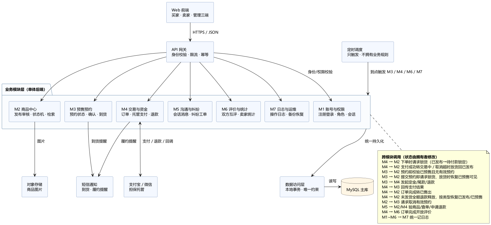

> 图 1 组件图。前端经 API 网关进入同一后端应用；M4 连接支付机构，M2 连接对象存储，定时调度只触发任务，具体业务仍由 M3/M4/M6/M7 处理。

## 四、UML 设计图

完整提交包含 11 组 PlantUML 源文件与 PNG。正文保留组件图、类图、状态图和时序图四种核心类型，其余用例图、异常状态图、订单状态图及活动图见提交包。

### 4.1 类图

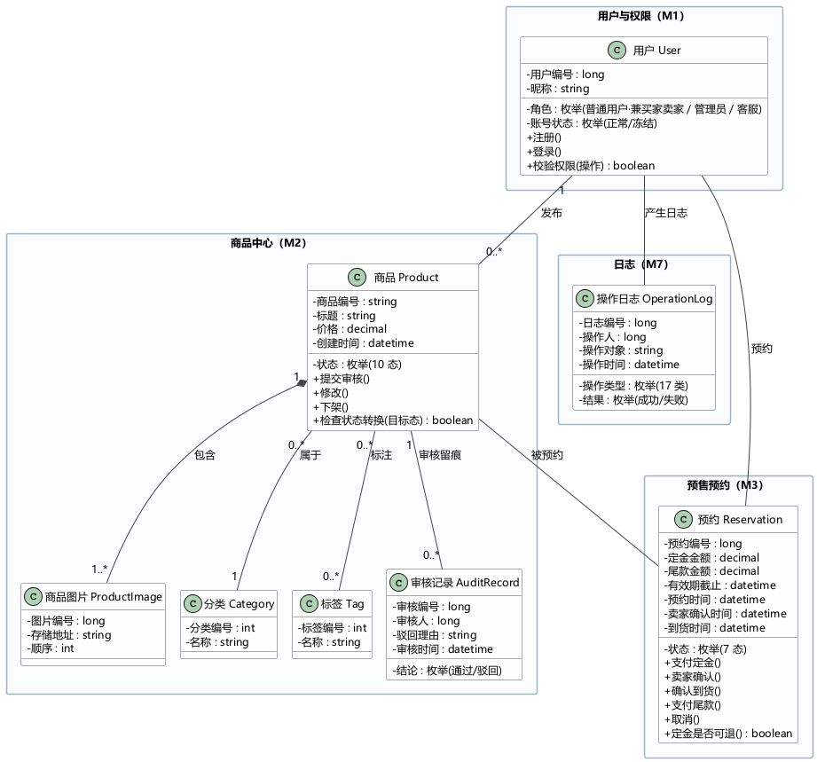

> 图 2 类图（一）。表达用户、商品、预约与日志的发布链：商品包含图片、分类、标签和审核记录；商品保留多条历史预约，但同时最多一条有效预约。

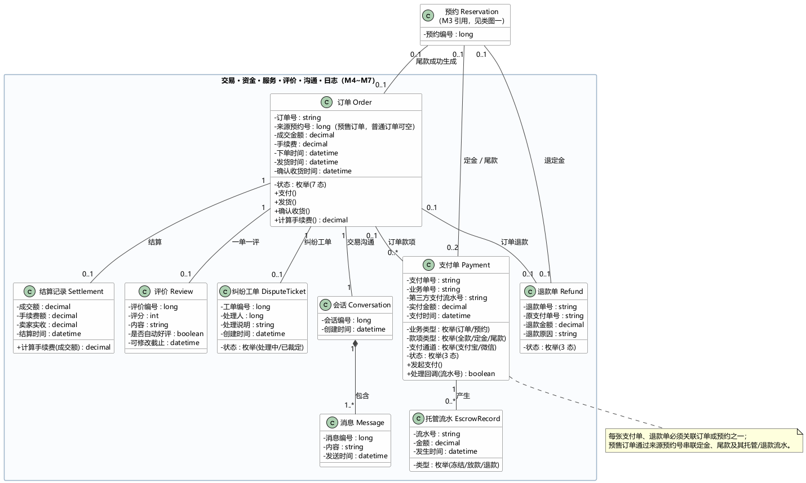

> 图 3 类图（二）。表达交易与资金链：预约记录履约过程，支付单记录一次具体付款；预售订单保存来源预约号，退款单关联原支付单，结算记录保存成交额、手续费与卖家实收。

### 4.2 商品状态图

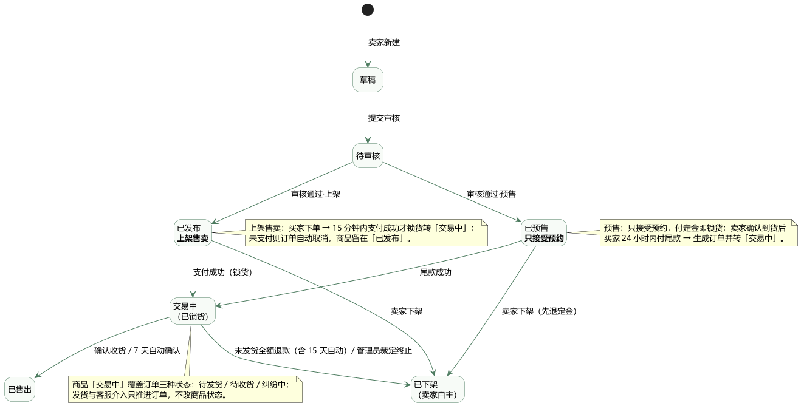

> 图 4 商品状态图（一）成交主线。普通商品创建订单即锁货，支付后进入交易中；预售商品在尾款成功后进入交易中。取消或超时放货，未发货退款恢复原销售状态，确认收货后转为已售出。完整异常与退出转换见提交包中的状态图（二）。

### 4.3 普通商品时序图

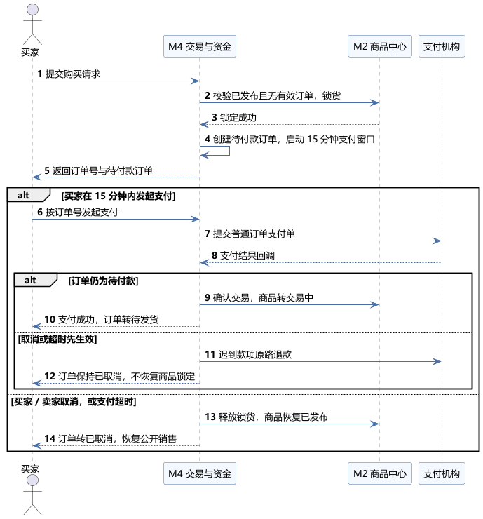

> 图 5 普通商品创建订单、支付与取消。M4 请求 M2 原子校验并锁货，锁货成功才创建待付款订单；支付与取消/超时只允许一个结果先生效，迟到支付只退款、不恢复订单。

### 4.4 预售商品时序图

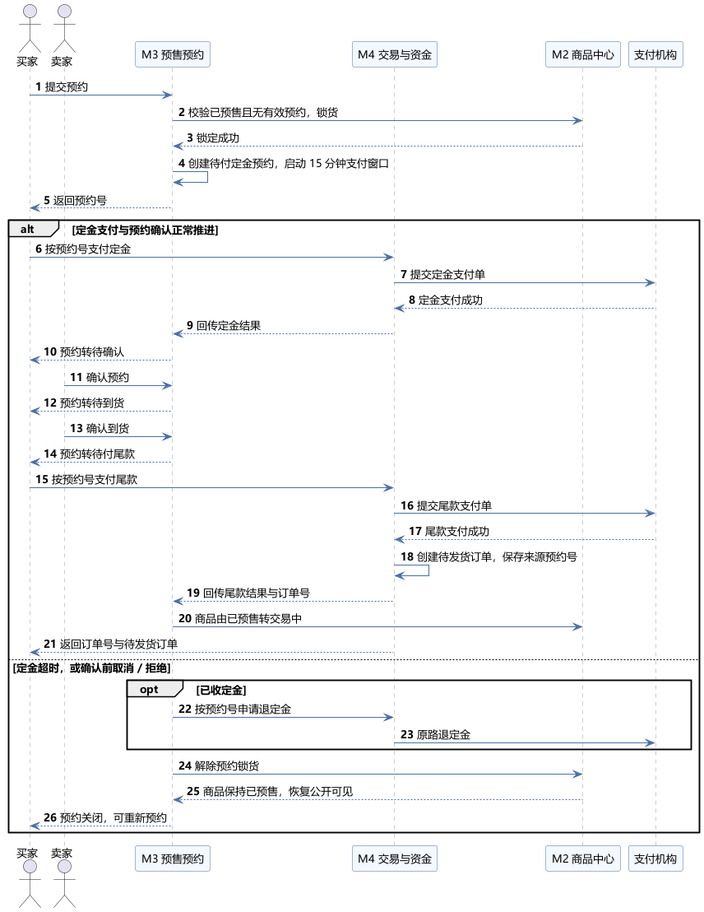

> 图 6 预售预约、定金、尾款与订单生成。M3 负责预约与确认，M4 分别处理定金和尾款支付单，尾款成功后才生成待发货订单；预约关闭时放货，定金是否退还需按确认前后区分。

## 五、UI 界面设计

以下 8 张界面设计示意图覆盖全部 7 个模块，使用 HTML/CSS 制作并由浏览器导出。数据为静态演示内容，按钮仅表达可操作性，目前未接后端。

### 5.1 登录 / 注册（M1）

> 图 7 登录 / 注册页。游客可浏览商品；登录与注册使用统一账号，登录后可发布、购买、预约和沟通。

### 5.2 我的商品（M2，卖家）

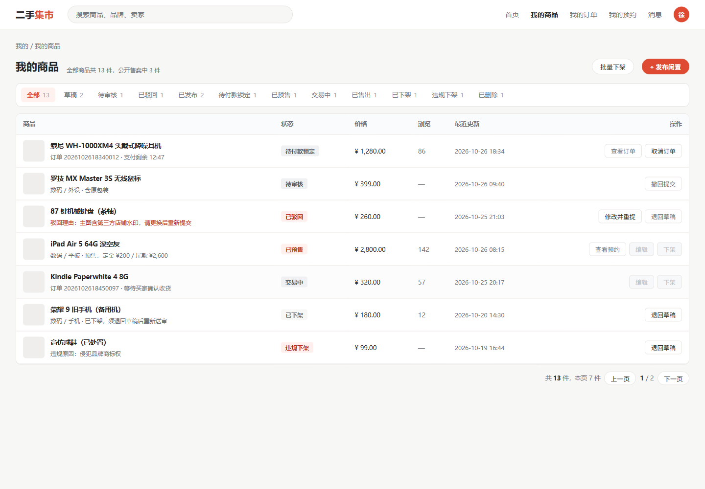

> 图 8 我的商品页。卖家按状态筛选商品，进行发布、编辑、下架和查看审核结果；待付款锁定商品可查看或取消关联订单。

### 5.3 商品详情（M2，买家）

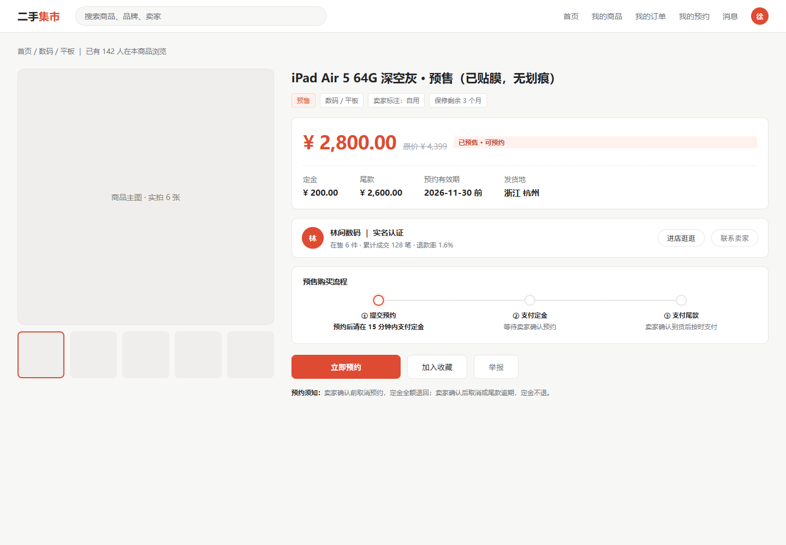

> 图 9 商品详情页。买家查看商品与预售信息，可咨询卖家、提交预约并支付定金；侧栏展示定金、尾款和取消规则。

### 5.4 预约管理（M3）

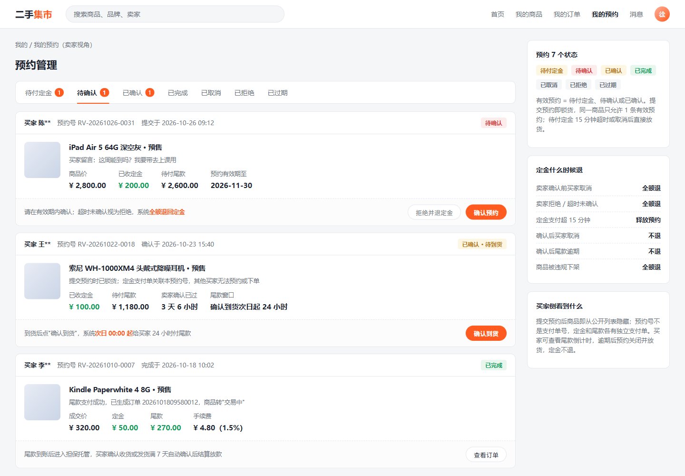

> 图 10 预约管理页。卖家处理预约确认、拒绝和到货确认，并查看定金、尾款进度；预约卡保留关联订单入口。

### 5.5 我的订单（M4）

> 图 11 我的订单页。买家按订单状态付款、查看履约或申请退款；侧栏展示担保交易、手续费和售后入口。

### 5.6 卖家数据统计（M6）

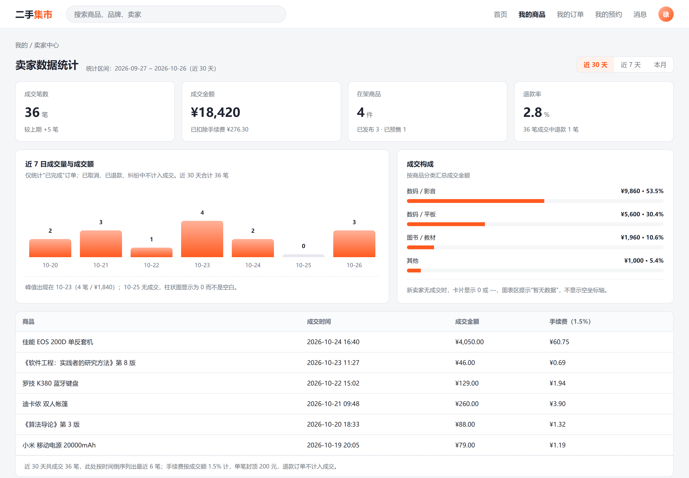

> 图 12 卖家统计页。卖家按时间查看成交笔数、成交金额、在架数和退款率，以及分类占比与商品明细。

### 5.7 关键操作日志（M7）

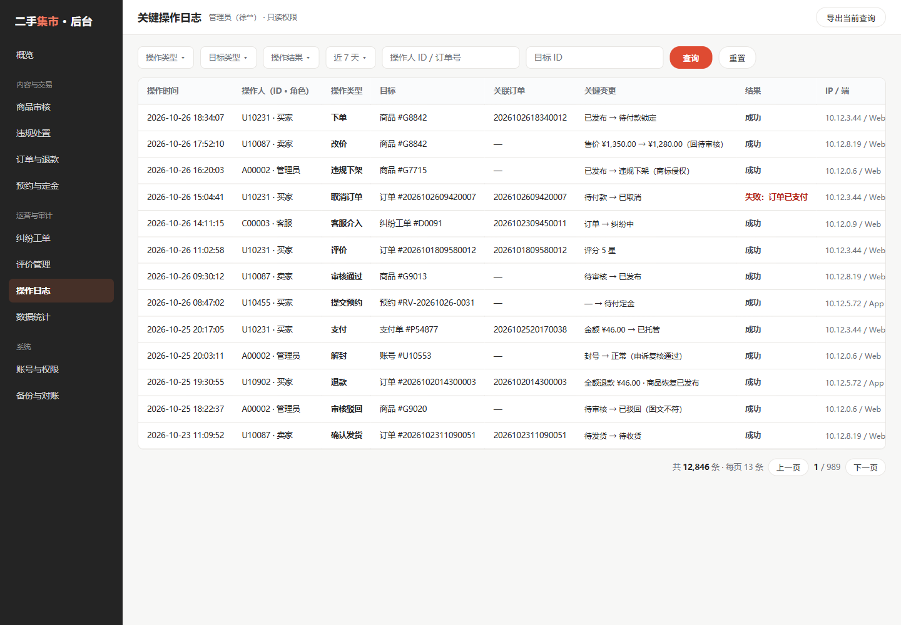

> 图 13 关键操作日志页。管理员与客服按操作、对象、结果和时间组合查询；日志只读，失败操作及原因同样留痕。

### 5.8 沟通与纠纷（M5）

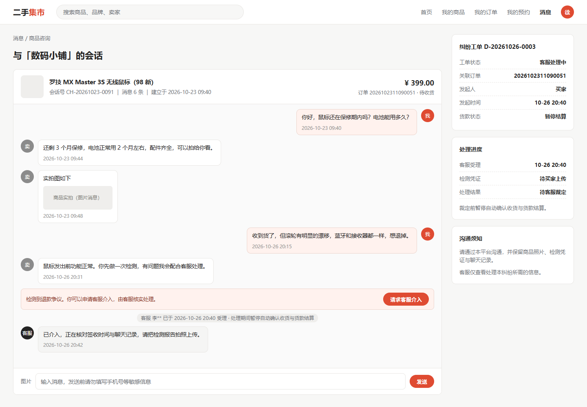

> 图 14 商品咨询与纠纷页。买卖双方围绕商品沟通，发生争议时可申请客服介入；右侧展示工单进度与处理须知。

## 六、AI 辅助使用记录

本实验采用“人负责业务决策、检查校对与最终确认”的工作流：先由人确定业务口径，再让 AI 生成图稿或文字；随后对照需求检查状态、迁移、分支和界面功能，实际渲染检查线路、文字与分页；发现问题后由人修改或指导修正，并用独立 Git 提交保存人工复核结果。

| 序号  | 使用场景与输出                                             | 人工检查与修改                                     | 可总结的经验                |
| --- | --------------------------------------------------- | ------------------------------------------- | --------------------- |
| 1   | 使用 DeepSeek V4.1 Flash 根据 lab01 需求生成用例图 PlantUML 初稿 | 初稿遗漏游客身份与权限，人工核对后补充                         | 参与者与权限必须回查原始需求        |
| 2   | 使用 DeepSeek V4.1 Flash 根据商品状态机生成商品状态图               | 逐条比对 25 条允许转换，发现单图线路复杂                      | 容易多画或少画边，复杂图需人工调整     |
| 3   | 使用 DeepSeek V4.1 Flash 提供多种组件图排版方案                  | 对比后决定把跨模块调用写入图注，减少箭头                        | AI 排版判断需结合实际效果        |
| 4   | 使用 DeepSeek V4.1 Flash 重新组织商品状态机并给出拆图方案             | 按成交主线与异常退出拆成两张图                             | 复杂状态图需要人主动拆分          |
| 5   | 调整锁货口径，指导 DeepSeek V4.1 Flash 简化订单状态图和支付时序图         | 删除注释虚线、SQL 与事务细节；修正不可下单分支错误流入支付的问题，并调整布局与字号 | 抽象层级、分支正确性和文字密度必须人工检查 |
| 6   | 根据七个模块生成界面初稿，后补 M5 沟通与纠纷图                           | 逐张对照需求调整预约状态、操作按钮和表述；将已发货订单的“申请退款”改为“联系客服”  | 生成版式较快，但业务文案需逐项核对     |
| 7   | 使用 KimiK3.1pro 检查 UML 图与文字一致性                       | 人工修正图文描述，例如将活动图“四泳道”改为“三泳道”                 | 图片修改后必须同步检查描述文档       |
| 8   | 使用 KimiK3.1pro 检查 UI 图与文字一致性                        | 人工复核并修改界面图注与操作说明                            | 多模态一致性仍需人工最终确认        |

AI 的优点是加快图稿、界面和文字初稿生成，并辅助发现一致性问题；局限是可能误解业务规则、生成错误分支或过时表述。因此，AI 输出不能直接作为最终结果，业务判断、图文核对和定稿必须由人完成。

## 七、实验总结

本实验的主要收获是明确“状态所有权单一”：商品、预约和订单分别由对应模块修改，跨模块只发指令。绘制过程中将复杂状态拆成商品与订单状态机，再用创建订单、支付、收货、退款和取消等事件衔接。AI 能加速图稿与文字初稿生成，但容易遗漏业务约束，并在图片修改后出现图文不一致，因此最终一致性与正确性必须由人检查确认。
