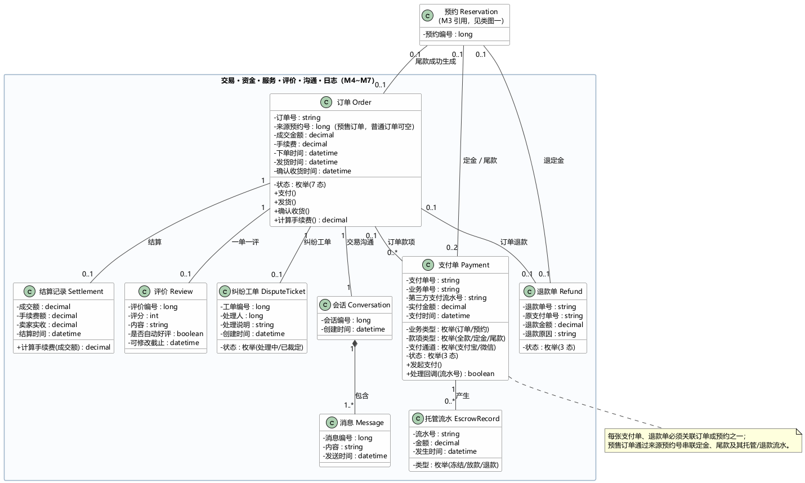
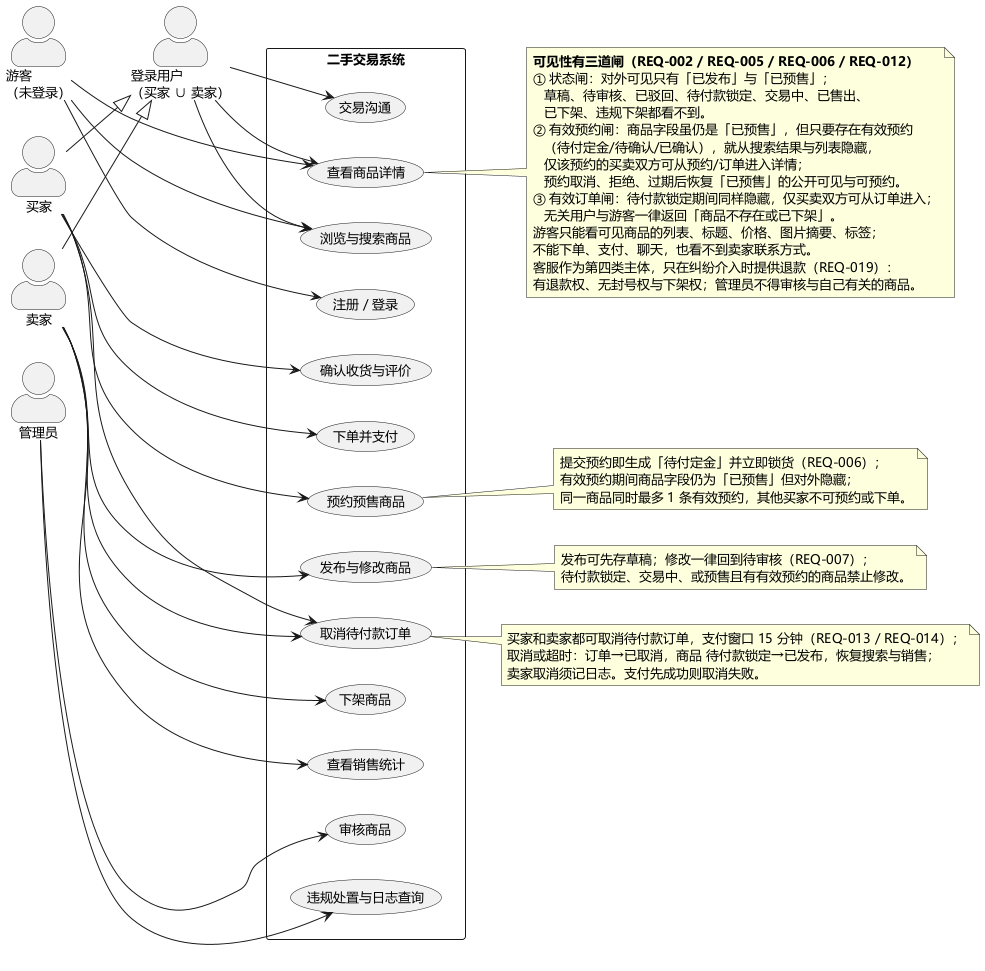
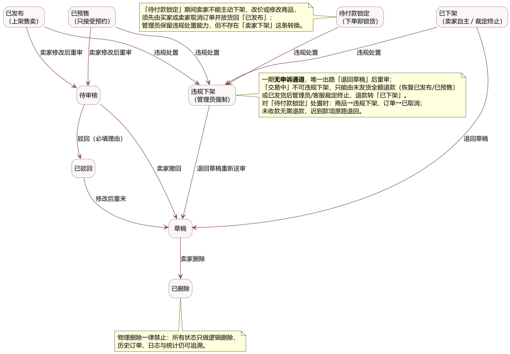
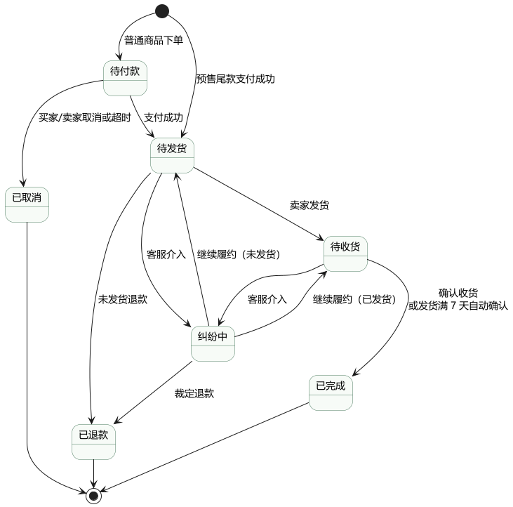
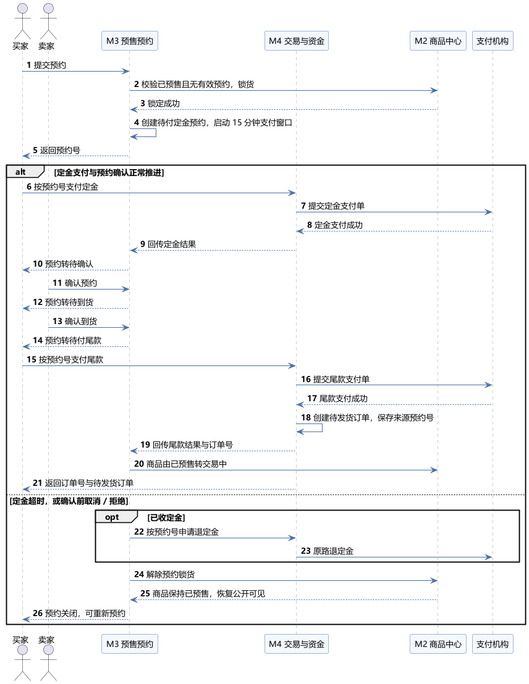
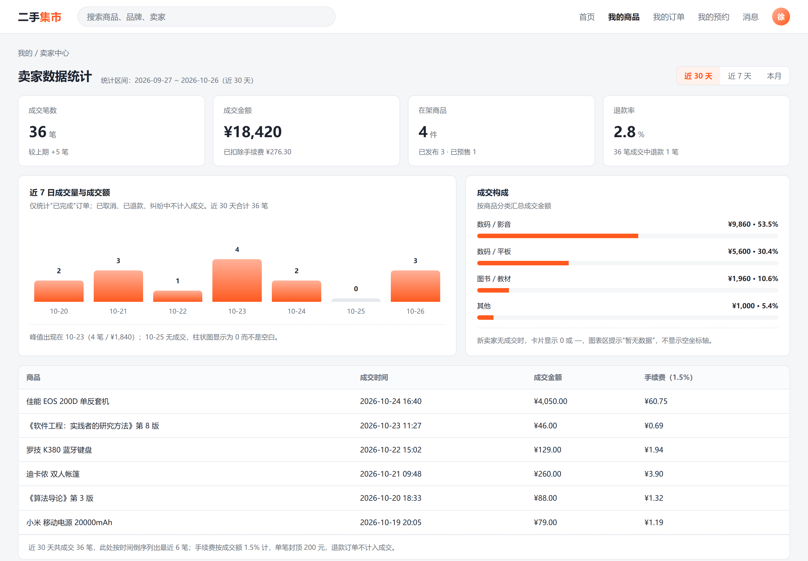
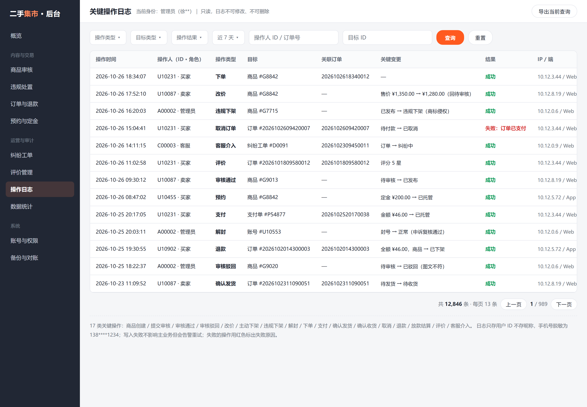

# 实验二：软件设计与建模 —— 实验报告（草稿）

> 说明：本文件是写作草稿与骨架，正文措辞需要你本人改写。实验要求（`2.md:26`）明确"实验报告的书写不允许使用大模型的辅助"，所以这里只提供事实、口径、图注和每节该写什么，句子请按你自己的表述重写一遍。

**项目**：项目 2 · 二手交易系统
**学号 / 姓名**：241220026 / 徐浩然

---

## 一、项目说明

本项目为一个基于校园生态的"二手交易系统"。
系统面向个人卖家与个人买家，提供商品的发布、审核、上架、检索、下单、支付、履约、退款、评价与统计能力，管理员负责审核商品与违规处置相关工作。

目前本项目只做网页端；支付走支付宝/微信担保托管，平台并不存储现金，现金流通过支付宝/微信，只提供相关放流等指令；商品分 11 个状态、允许 25 条状态转换，通过商品状态机进行严格限制。

---

## 二、主要功能

我按照业务对象把系统切成 7 个模块，每个模块既负责某类特定操作，便于分布部署与启用；其他模块通过调用拥有者暴露的接口调用执行相关功能。

| 模块           | 负责内容                                                        | 明确不负责                                   | 对应需求                       |
| ------------ | ----------------------------------------------------------- | --------------------------------------- | -------------------------- |
| **M1 账号与权限** | 注册登录、买家/卖家统一账号、会话、权限规则与敏感信息保护策略；拥有用户和会话数据                   | 不处理商品、预约、订单的具体业务；资源是否属于本人由对应业务模块配合校验    | REQ-001/002/026/027        |
| **M2 商品中心**  | 商品草稿、审核、修改重审、下架、违规处置、检索；拥有商品、图片、分类、标签、审核记录及商品状态机            | 不直接处理支付和退款；游客浏览内容可见性过滤在本模块执行            | REQ-003~005/007~012/024    |
| **M3 预售预约**  | 创建预约并锁货、定金支付、卖家确认、确认到货、取消与失效；拥有预约记录及预约状态机                   | 不直接记资金流水，不负责订单发货、收货和结算                  | REQ-006                    |
| **M4 交易与资金** | 下单、支付发起与回调、订单履约、担保托管、退款、结算和手续费；拥有订单、支付单、托管流水、退款单、结算记录及订单状态机 | 不直接修改商品状态，不替 M3 判断预约规则，不替 M5 处理聊天和工单    | REQ-013~017/025/028（资金一致性） |
| **M5 沟通与纠纷** | 商品咨询会话、文字与图片消息、纠纷识别、客服介入和纠纷工单；拥有会话、消息和工单数据                  | 不直接退款或修改订单状态；客服无封号、下架权，管理员的违规处置仍由 M2 执行 | REQ-018/019/031（待确认）       |
| **M6 评价与统计** | 买卖双方互评、自动好评、评价修改/删除/申诉、卖家成交量/在架数/退款率统计；拥有评价数据               | 不判定订单是否完成，不直接修改订单或商品                    | REQ-020/021                |
| **M7 日志与运维** | 关键操作日志、日志组合查询与权限、每日备份和恢复；拥有不可篡改的操作日志                        | 不实现各业务的超时规则；调度器只触发任务，具体处理仍归 M3/M4/M6    | REQ-022/023/028（备份恢复）      |

---

## 三、软件架构

### 3.1 分层与部署

系统分五层，自外向内：

```
浏览器 / 前端页面
      │ HTTPS + JSON
   API 网关（接入、身份校验、限流、统一错误码）
      │
   业务模块层（M1 ~ M7，同一后端应用内的逻辑模块）
      │
   数据访问层（DAO / 本地事务边界）
      │
   MySQL（商品、预约、订单、资金、日志）
```

M1~M7 可以分别开发和测试，但一期作为一个后端应用统一部署，共享 MySQL，不作为七个独立服务部署。数据访问层提供统一的持久化与事务机制，不代表任何模块都能直接更新其他模块的表；跨模块状态变化仍须经过模块接口。

外部依赖四个：支付宝/微信担保托管（支付、退款与放款）、对象存储（商品图片）、短信通知（到货与履约提醒）、定时调度（到点触发各模块任务）。

### 3.2 模块之间的交互

| 调用方向 | 触发场景 | 职责划分 |
|---|---|---|
| 网关 / 业务模块 → M1 | 登录、身份识别和角色权限校验 | M1 提供统一身份与权限规则，不反向调用各业务模块 |
| M3 → M2 | 预约前查询商品为“已预售”且无有效预约；预约关闭后恢复公开销售 | M2 提供商品事实并执行可见性变化，M3 判断能否建立预约 |
| M3 → M4 | 发起定金、尾款支付或退定金 | M3 判断预约业务规则，M4 执行资金动作 |
| M4 → M3 | 支付回调后返回定金/尾款处理结果 | M3 据此推进预约状态；尾款成功后预约完成 |
| M4 → M2 | 创建订单时锁货、支付成功转交易中、交易完成转已售出、取消或未发货退款后恢复原销售状态 | M4 发指令，M2 校验并执行商品状态转换，M4 不直接修改商品数据 |
| M2 → M3 | 已预售商品违规下架且存在有效预约 | M3 取消预约，再通过 M4 全额退定金 |
| M5 → M2 / M4 | 会话前校验商品；纠纷中查询订单、申请订单状态变更或退款 | M5 管会话与工单，商品和订单仍分别由 M2、M4 修改 |
| M4 → M6 | 订单完成后提供评价资格和统计所需事实 | M6 负责评价与统计，不回写订单 |
| M1~M6 → M7 | 关键操作统一留痕 | M7 统一日志格式与查询入口，日志失败按需求告警重试 |

### 3.3 两条购买主流程

**普通商品：创建订单时锁货，支付成功后进入履约。**

1. 买家通过 M1 校验身份，M4 根据 M2 提供的商品信息创建“待付款”订单，同时由 M2 将商品从“已发布”转为“待付款锁定”。创建订单与锁货同时成功或同时失败，同一商品只允许一条有效订单。
2. 买卖双方在 15 分钟支付窗口内完成后续操作。买家或卖家取消、支付超时，订单转为“已取消”，商品恢复“已发布”。
3. 支付成功后订单转为“待发货”，商品转为“交易中”。若取消或超时先生效，迟到的支付结果不恢复订单，实际到账款项原路退回。
4. M4 继续处理发货、确认收货、退款和结算；交易完成时由 M2 将商品改为“已售出”，再由 M6 处理互评和卖家统计。

**预售商品：先进入 M3 预约，不是先由 M4 创建普通订单。**

1. M2 审核发布商品时，根据卖家选择把商品置为“已预售”；是否预售在发布阶段已经确定。
2. 买家点击预约后，M3 创建“待付定金”预约并立即锁货，买家须在 15 分钟内支付定金；超时或取消则关闭预约并放货。
3. M3 请求 M4 处理定金。定金支付成功后，M3 推进预约状态；商品字段仍为“已预售”，但存在有效预约期间不公开显示，也不转为“交易中”。
4. 卖家在 M3 确认预约、确认到货，之后等待买家支付尾款。
5. 尾款支付成功后由 M4 生成订单并保存来源预约号，调用 M2 将商品从“已预售”改为“交易中”，再由 M3 将预约置为“已完成”。
6. 后续发货、收货、退款、放款与普通订单一样由 M4 负责，完成后再进入 M6。

**预约与支付单不是同一个概念。** 预约是买家对预售商品的交易意向与履约记录，提交预约后即获得预约号；即使尚未支付定金，“待付定金”预约也已经存在。支付单是 M4 针对一次具体付款建立的资金记录，定金和尾款分别对应不同支付单，不能用预约号代替支付流水，也不能把“预约已创建”理解为“已经付款”。尾款成功前按预约号追查定金；尾款成功后生成订单号，并通过来源预约号把订单、定金支付单和尾款支付单串联起来。退定金也不会把预约变成支付单，而是另建关联原定金支付单的退款记录。

**有效预约期间商品不公开显示。** 无有效预约的“已预售”商品可以被搜索和预约；一旦存在有效预约，商品即从搜索和列表隐藏，仅买卖双方能从预约或订单进入详情。预约取消、拒绝或过期后恢复公开可见。M2 负责商品可见性，M3 提供有效预约事实。

**异常流程也按状态所有权处理。** 卖家确认前买家取消、卖家拒绝或超时未确认，M4 全额原路退定金并放货；卖家确认后买家取消或尾款逾期，定金不退但仍须放货；已预售商品违规下架时，M2 通知 M3 取消有效预约，M3 再请求 M4 全额退定金。纠纷介入时，M5 建工单并请求 M4 暂停自动履约或退款，M5 不直接改订单和资金记录。

### 3.4 为什么这样设计（报告里必须写这一段）

1. **按业务对象切模块，不按页面切。** 按“我的商品页/详情页/订单页”切会让同一份状态判断散在多个页面里；按商品、预约、订单、资金切，每类状态都有明确的修改入口。
2. **状态的所有权单一。** 商品状态只由 M2 修改，预约状态只由 M3 修改，订单状态只由 M4 修改。跨模块只发指令、不直接改其他模块的数据，避免多台状态机漂移。
3. **预约、订单与商品解耦。** M3 管预约规则，M4 管订单和资金单据，M2 管商品是否可售；支付幂等与并发、预约有效期、商品状态机可以分别测试。
4. **一期不引入消息队列。** 当前规模下，单体应用内的同步调用与本地事务已经足够；MQ 会增加部署、失败恢复和幂等处理成本，后续确有异步解耦需求时再引入。短信、评价通知与日志重试不应导致已提交的支付或订单事务回滚。

### 3.5 图：组件图


> 图 1 组件图。前端经 API 网关进入同一后端应用内的 M1~M7，各模块通过数据访问机制共享 MySQL，但不直接修改其他模块的数据。M4 连接支付宝/微信担保托管，M2 连接对象存储，M3/M4 使用短信通知。跨模块调用在图注中列出，以避免连线交叉。

定时调度只画一条指向业务模块层的触发关系，不再用四条长曲线分别连接模块。具体任务是：M3 处理预约、定金和尾款超时，M4 处理待付款超时取消、自动确认与退款，M6 处理自动好评和申诉提醒，M7 执行每日备份；调度器只负责到点触发，不拥有业务规则。

退款与放货必须区分：未发货全额退款后，普通商品恢复“已发布”、预售商品恢复“已预售”，自动恢复搜索与销售，不重新送审；已发货后裁定终止或退款，商品转“已下架”，再走草稿重新上架。预约取消、拒绝或过期后的放货不改变“已预售”字段，只恢复公开可见与可预约。

---

## 四、UML 设计图

按要求三类各至少一张，类图必画。本设计实际给出 11 张：

| 类别 | 图 | 文件 |
|---|---|---|
| 结构性 | 类图（一）用户·商品·预约·日志 | `UML/类图1_用户商品预约.png` |
| 结构性 | 类图（二）交易·资金·服务·评价·沟通 | `UML/类图2_交易资金服务.png` |
| 结构性 | 组件图 | `UML/组件图.png` |
| 行为性 | 用例图 | `UML/用例图.png` |
| 行为性 | 状态图（一）成交主线 | `UML/状态图.png` |
| 行为性 | 状态图（二）异常与退出 | `UML/状态图2_异常与退出.png` |
| 行为性 | 订单（交易）状态图 | `UML/订单状态图.png` |
| 行为性 | 活动图（一）下单与支付 | `UML/活动图1_下单与支付.png` |
| 行为性 | 活动图（二）发货收货与结算 | `UML/活动图2_发货收货与结算.png` |
| 交互性 | 时序图（一）普通商品创建订单、支付与取消 | `UML/时序图.png` |
| 交互性 | 时序图（二）预售预约、定金、尾款与订单生成 | `UML/时序图2_预售预约与支付.png` |

### 4.1 类图


> 图 2 类图（一）。表达发布链：用户发布商品，商品包含图片、归属分类、标注标签、留审核记录；预售商品可被预约。角色枚举区分普通用户（兼买家与卖家两种身份）、管理员、客服三类主体；操作日志挂在操作人上，故与用户同簇。“商品 1—0..* 预约”表示保留多条历史预约，同商品同时最多 1 条有效预约。商品字段为“已预售”不等于公开可见：存在有效预约时商品从搜索和列表隐藏，仅买卖双方可从预约或订单进入；预约关闭后恢复公开。



> 图 3 类图（二）。表达交易与资金链：预约记录预售履约过程，支付单记录一次具体付款，二者不是同一对象。支付单通过“业务类型 + 业务单号”关联普通订单或预售预约，并区分全款、定金、尾款；每张支付单可产生多条托管流水。预售订单保存来源预约号，因此能串联定金与尾款；退款单记录原支付单号，可关联订单退款或预约退定金。订单各自对应 0..1 的结算记录、评价与纠纷工单（同一订单只允许一张纠纷工单）；订单绑定一个会话，会话包含多条消息。结算记录中保存成交额、手续费额与卖家实收，手续费按成交额 1.5%（通道费 0.6% + 平台费 0.9%）计算、单笔封顶 200 元。

**为什么拆成两张**：16 个类放在一张图里，跨包关系有 8 条长连线，Graphviz 为避让交叉会把弧线拉满整张画布，读起来反而更乱；按"发布链 / 交易链"拆开后每张不超过 10 个类，字号也能放大。

### 4.2 用例图



> 图 4 用例图。五类参与者：游客、登录用户、买家、卖家、管理员；买家与卖家继承登录用户。游客只能浏览、搜索、查看详情、注册登录；交易类用例需登录。客服作为第四类主体不单列为参与者（会打乱用例布局），其权限写在图注：只在纠纷介入时提供退款，有退款权、无封号权与下架权。

### 4.3 状态图（商品）

商品共 11 个状态、25 条允许转换，拆成两张图表达，两张合计恰好是这 25 条、不重复不遗漏。


> 图 5 状态图（一）成交主线。普通商品创建订单后即从已发布转为待付款锁定，支付成功再转为交易中；预售商品在尾款成功后从已预售转为交易中。确认收货后转为已售出；未发货全额退款时，普通商品恢复已发布，预售商品恢复已预售。待付款订单取消或超时则释放为已发布。商品“交易中”覆盖订单的待发货、待收货和纠纷中，发货与客服介入只推进订单，不改变商品状态。图中将已发布、已预售分列两侧，交易中、已售出和已下架放在下方；隐藏线只用于对齐，不是业务转换。
>
> 锁货与可见性规则不再堆成图内注释：待付款锁定期间，商品从搜索和列表隐藏，同一商品最多一条有效订单，卖家须先取消订单才能修改或下架；存在有效预约时，已预售商品同样不公开。普通未发货退款与已发货裁定退款必须区分，前者恢复原销售状态，后者才进入已下架。



> 图 6 状态图（二）异常与退出。审核驳回、卖家撤回、修改后重审、卖家下架后只能退回草稿、违规下架、草稿删除。待付款锁定商品也可被管理员违规处置，此时关联订单取消，不能按普通取消恢复销售。已发货后经客服或管理员裁定终止、退款的商品转为已下架。违规下架一期无申诉通道，唯一出路是退回草稿重新送审；已下架商品不可直接上架。

### 4.4 订单状态图



> 图 7 订单状态图。图中只保留 7 个状态和关键迁移，不把商品联动与实现注意事项画成注释。普通商品下单后进入待付款，买家或卖家取消、15 分钟超时都会取消订单并放货；预售订单在尾款成功后直接进入待发货。卖家应在 48 小时内发货，买家确认收货或发货满 7 天后订单完成。未发货退款包括买家申请与超 15 天未发货自动退款，退款后普通商品恢复已发布、预售商品恢复已预售；已发货后须客服或管理员介入，裁定退款时商品转已下架。纠纷继续履约时回到原来的待发货或待收货状态。

### 4.5 活动图


> 图 8 活动图（一）下单与支付。四泳道（买家/平台系统/支付机构/卖家），表达从点击购买到创建订单并锁货、再完成支付的主流程。同一商品只允许一条有效订单；同一买家重复提交时返回原待付款订单，其他买家在锁定期不能下单。买家或卖家取消、15 分钟超时都会放货；若取消或超时先于支付结果生效，迟到款项原路退回，不恢复订单。


> 图 9 活动图（二）发货收货与结算。表达支付成功之后的履约：卖家 48 小时内发货，超时买家可申请退款、超 15 天系统自动全额退款；买家主动确认收货或发货满 7 天自动确认。客服介入后进入纠纷中，裁定退款或继续履约；未发货退款后商品按普通/预售类型恢复原销售状态，已发货后裁定退款则下架。完成后结算放款并开放 14 天互评。

### 4.6 时序图（普通商品与预售商品）

两类商品的参与者和业务步骤不同，因此拆成两张图。两张图各自表达模块职责与购买/预购业务执行过程，仅突出买家购买直至生成相应的具体订单的流程，不涉及后续卖家发货相关流程。


> 图 10 时序图（一）普通商品创建订单、支付与取消。买家提交购买后，M4 请求 M2 校验并锁货，锁货成功才创建待付款订单并启动 15 分钟支付窗口。买家按订单号发起支付，M4 创建支付单并接收回调；订单仍待付款时，商品转交易中、订单转待发货。买家或卖家取消、支付超时时，M4 请求 M2 放货并恢复公开销售；若取消或超时先生效，迟到款项原路退回，订单不恢复。商品不可下单与重复提交由活动图表达，数据库与并发控制留到实验三。



> 图 11 时序图（二）预售预约、定金、尾款与订单生成。提交预约时，M3 请求 M2 锁货并创建待付定金预约；定金与尾款分别形成支付单，但都用预约号关联业务，预约不等于支付单。卖家确认预约、确认到货后，买家支付尾款；尾款成功时 M4 才创建待发货订单，保存来源预约号并返回订单号，M3 再通知 M2 将商品转为交易中。定金超时或确认前取消、拒绝时关闭预约并放货，已收定金原路退回；卖家确认后的取消或尾款逾期不退定金，但也必须放货，具体规则见 REQ-006。

---

## 五、UI 界面设计

现有界面图共 8 张，覆盖全部 7 个功能模块：M2 按卖家与买家视角拆成 2 张，M1、M3、M4、M5、M6、M7 各 1 张。制作方式是每个界面写一个 HTML + 公共 CSS，再用无头浏览器按 1440×1000 渲染成 PNG：这样版式由样式表统一控制、文字改一行就能重出图，比在绘图工具里手工摆控件更容易保持一致，也便于后续把图换成真实前端。

需要说明的是，这 8 张是**界面设计示意图**，不是可运行的原型：数据是演示用的静态内容，按钮只表达可操作性（置灰、隐藏、状态提示），不接后端。

| 模块 | 界面 | 服务对象 | 文件 |
|---|---|---|---|
| M1 | 界面 1 登录 / 注册 | 游客 | `UI界面/界面1_登录注册.png` |
| M2 | 界面 2 我的商品 | 卖家 | `UI界面/界面2_我的商品_卖家.png` |
| M2 | 界面 3 商品详情 | 买家 / 游客 | `UI界面/界面3_商品详情_买家.png` |
| M3 | 界面 4 预约管理 | 卖家（买家侧同页结构） | `UI界面/界面4_预约管理.png` |
| M4 | 界面 5 我的订单 | 买家 | `UI界面/界面5_我的订单.png` |
| M6 | 界面 6 卖家数据统计 | 卖家 | `UI界面/界面6_卖家统计.png` |
| M7 | 界面 7 关键操作日志 | 管理员 / 客服 | `UI界面/界面7_日志查询.png` |
| M5 | 界面 8 沟通与纠纷 | 买家 / 卖家 / 客服 | `UI界面/界面8_沟通与纠纷.png` |

### 5.1 界面 1：登录 / 注册（M1）


> 图 12 登录 / 注册页。左侧说明统一账号口径：同一个手机号只有一个账号，同一个人既能发闲置也能买东西，不区分买家版与卖家版；右侧是验证码登录与注册两个 tab，未注册的手机号登录时自动建号，省掉一次"先注册再登录"。页面底部明确写出游客权限边界——游客可浏览、搜索、看详情，点到下单、预约、聊天、评价时才跳回本页。按实验一需求，平台没有"冻结账号"这一处置，所以页面上不设冻结提示。

### 5.2 界面 2：我的商品（M2，卖家）


> 图 13 我的商品页。顶部状态 tab 列出商品的 11 个状态并带计数（含已删除）。待付款锁定商品显示关联订单和剩余支付时间，卖家可查看或取消订单，但不能直接编辑、下架；交易中和存在有效预约的预售商品同样限制修改。页脚摘要说明 25 条允许转换，以及取消放货、未发货退款恢复原销售状态的规则。

### 5.3 界面 3：商品详情（M2，买家）


> 图 14 商品详情页。预售流程从提交预约并锁货开始，之后在 15 分钟内支付定金、等待卖家确认，到货后再付尾款。页面明确区分预约号、定金/尾款支付单和尾款成功后生成的订单号。确认前取消或卖家拒绝全额退定金，确认后取消或尾款逾期不退；待付款锁定和存在有效预约的预售商品均从公开搜索与列表隐藏，仅相关买卖双方可进入。

### 5.4 界面 4：预约管理（M3）


> 图 15 预约管理页（卖家视角）。顶部 tab 展示 7 个状态，包含待付定金；有效预约包括待付定金、待确认和已确认，同商品同时只允许 1 条。提交预约即锁货，待付定金 15 分钟超时或取消后直接放货；卖家在待确认时可确认预约或拒绝并退定金，确认后不再提供退定金取消按钮。预约卡同时展示预约号、定金/尾款支付信息及尾款成功后关联的订单号。

### 5.5 界面 5：我的订单（M4）


> 图 16 我的订单页。待付款卡明确创建订单时已锁货，并显示 15 分钟支付倒计时；待发货卡显示卖家需在 48 小时内发货；待收货卡以发货时间起算 7 天自动确认。侧栏说明担保交易的资金路径和手续费，并区分未发货退款与已发货纠纷：前者由普通/预售商品分别恢复已发布/已预售，后者须客服介入。

### 5.6 界面 6：卖家数据统计（M6）



> 图 17 卖家统计页。默认看近 30 天，四张指标卡分别给成交笔数、成交金额（注明已扣手续费）、在架商品数、退款率，每张卡下带一句对比或口径说明。左侧柱状图按天给成交量与成交额，右侧横条给商品分类的成交占比；明细表逐商品列成交笔数、金额、退款笔数与退款率。空数据不画空白：无成交的日期柱高为 0，新卖家无成交时卡片显示 0、图表显示"暂无数据"并隐藏坐标轴。

### 5.7 界面 7：关键操作日志（M7）



> 图 18 关键操作日志页（管理员 / 客服）。左上角标明当前身份与"只读，日志不可修改、不可删除"。筛选区按操作类型、目标类型、操作结果、时间范围与操作人/订单号组合查询。表格除时间、操作人（只存 ID 不存昵称）、操作类型外，还记录目标、关联订单、关键变更（如"售价 ¥1,350.00 → ¥1,280.00"）与结果；失败的操作以红色标出原因（如"失败：订单已支付"），说明失败也要留痕。页脚列出 17 类关键操作，并注明手机号脱敏为 138****1234。

### 5.8 界面 8：沟通与纠纷（M5）


> 图 19 商品咨询会话页。会话与商品绑定，页头直接给出商品、会话号、消息数与关联订单，买卖双方共用同一会话，重复进入不新建（同一买卖双方就同一商品只保留一个会话）。消息区分买家、卖家与客服三种身份，图片消息按附件呈现，时间戳逐条保留；任何一方都不能单方面删除记录，只能本地隐藏，无关第三方请求会话内容一律拒绝。买家就"已发货商品能否退款"提出异议时，系统只弹出一条介入提示、不判定责任、不自动退款，由用户点"请求客服介入"发起工单。右侧三张卡片说明会话可见范围、纠纷工单（同一订单只建 1 张、纠纷期间订单不自动确认也不放款）与客服权限边界：有退款权，无封号权与下架权，处理说明必填并留痕。

---

## 六、AI 辅助使用记录（这一章必须你本人写）

要求：单独一章，**每一次**使用都记四要素——使用场景、生成结果、优缺点分析、修改优化后的结果，结尾总结大模型如何辅助软件设计。下面只是本项目里真实发生过的使用清单，供你按自己的经历回忆和改写，不要照抄。

| 序号  | 使用场景                                | 生成/得到什么        | 你怎么改的                                  | 可总结的优缺点         |
| --- | ----------------------------------- | -------------- | -------------------------------------- | --------------- |
| 1   | 让 AI 根据lab01的需求分析给出用例图的 PlantUML 初稿 | 得到对应的用例图       | 初版中并没有考虑到游客这一身份，没有列出游客在这个系统中的权限，于是增加游客 |                 |
| 2   | 让 AI 根据商品状态机画出对应的商品状态图           | 一批状态与转换        | 与需求里的 25 条允许转换逐条比对，删掉非法边，例如交易中→违规下架    | 容易多画或少画边，必须回查需求 |
| 3   | 让 AI 提供多种组件图排版方案                    | 多版排版方案         | 最后决定跨模块调用写图注而不是画箭头                     | 排版判断力弱，需人看效果    |
| 4   | 重新绘制商品状态机，拆分为成功交易与交易失败两条路线          | 拆成两张UML图的方案    | 按发布链/交易链拆，类图从 16 类一张变 2 张              | 能提方案，取舍要自己定     |
| 5   | 核对图与需求是否一致                          | 逐条比对，找出 13 处偏差 | 自己判断哪些是错、哪些是口径问题                       | 查漏有效，但结论要人工复核   |
| 6   | 让它给七个模块各出一版界面草图（HTML+CSS，便于改字），后续再补 M5 沟通与纠纷一张      | 七张界面初稿，后补 1 张 | 逐张对照需求改：删掉需求里没有的"冻结账号"提示；预约状态由 7 个改回 6 个；已发货订单的"申请退款"改成"联系客服"；统计页明细补足行数避免留白 | 版式生成快，但业务口径与状态数几乎每次都要人工纠 |
| 7   | 调整下单锁货口径，并指导 DeepSeek 简化订单状态图和支付时序图 | 创建订单即锁货的图稿，以及两版过度细化的状态图、时序图 | 状态图删去注释虚线，只留状态与关键迁移；时序图删去 SQL、事务与数据库细节。普通商品保留四条生命线并补齐支付、取消分支；预售改用独立时序图表达六条生命线；初稿中不可下单分支错误流入支付的问题已修正；后续按人工审图意见下移“已售出”、简化“违规处置”标签，并将两张活动图字号从 12 调整为 16 | 初稿容易把实现注意事项全堆进图；抽象层级、分支正确性与图上文字密度仍需人工检查 |

结尾那段总结建议从三个角度写：AI 擅长什么（生成结构、查漏、给备选方案）、不擅长什么（业务口径、排版判断、取舍）、你最终形成的用法（先自己定口径 → 让 AI 出初稿 → 逐条回查需求）。

---

## 七、实验总结

建议写四点：

1. 设计上最大的收获是"状态所有权单一"——每个状态只在一处被修改，跨模块只发指令；
2. 商品状态图与订单状态图分两台状态机表达，中间靠创建订单、支付成功、确认收货、退款成立、取消这五类事件衔接；图只画关键状态与迁移，具体联动规则放在文字中说明；
3. 取舍：一期不引入消息队列、不做部分退款、不做已发货后的退货；
4. 不足：界面只做到设计示意图，没有真实前端与交互实现，也没有做可用性测试；类图字段仍需在实现阶段补齐。

---

## 附：提交物清单

```
实验2_241220026_徐浩然/
├── 实验报告.pdf
├── UML/            （10 张 png + 10 个 puml）
└── UI界面/         （8 张 png）
```

---

### 待你确认的两件事

1. 报告要不要**附上主要接口/数据表说明**（不强制，但能让设计显得完整）？
2. 章节顺序是否按你习惯（功能→架构→UML→UI→AI→总结）调整？