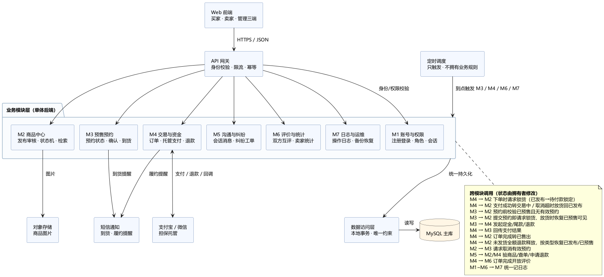
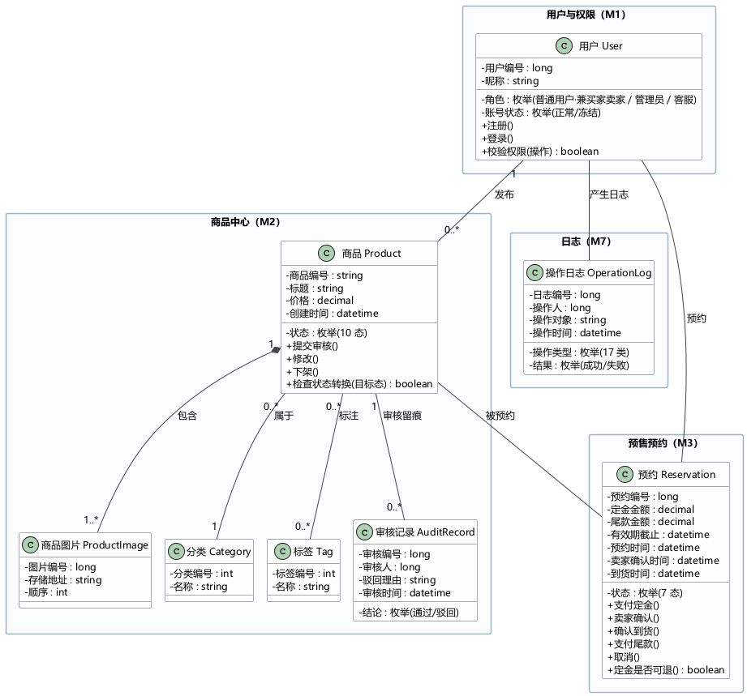
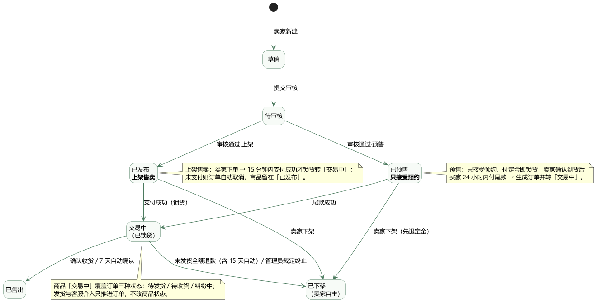
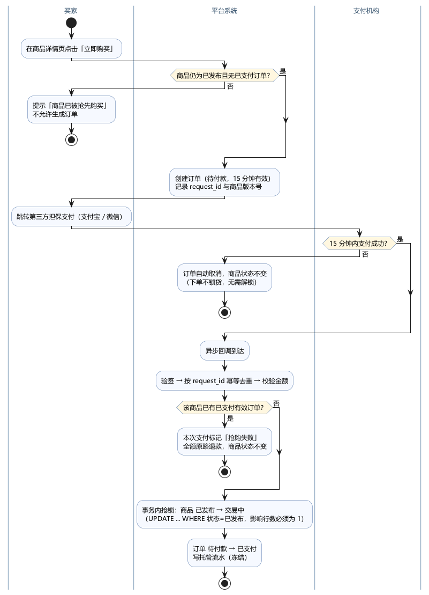
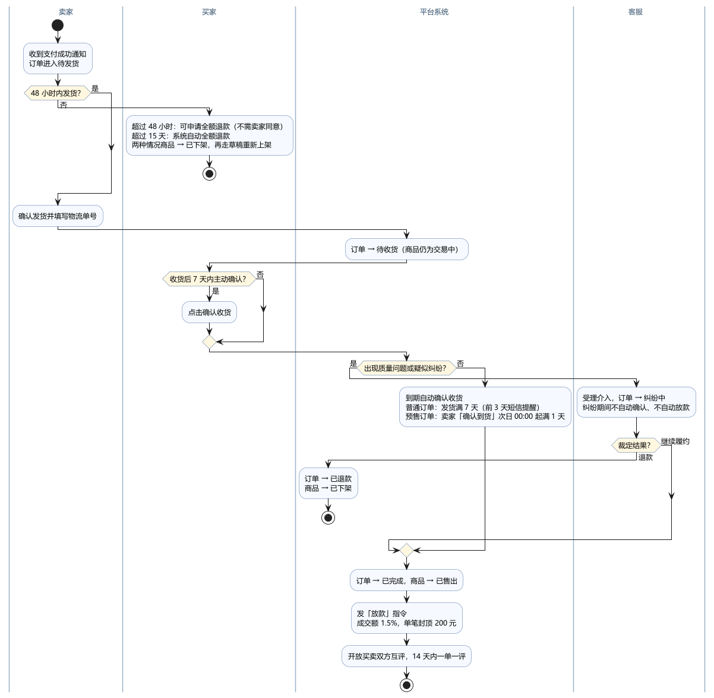
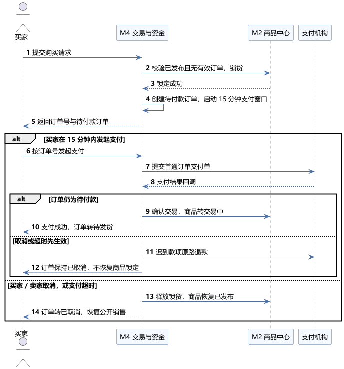

# 实验二：软件设计与建模 —— 实验报告（草稿）

> 说明：本文件是写作草稿与骨架，正文措辞需要你本人改写。实验要求（`2.md:26`）明确"实验报告的书写不允许使用大模型的辅助"，所以这里只提供事实、口径、图注和每节该写什么，句子请按你自己的表述重写一遍。

**项目**：项目 2 · 二手交易系统（承接实验一 `requirements.md` 的 REQ-001~031）
**学号 / 姓名**：241220026 / 徐浩然

---

## 一、项目说明

本次设计延续实验一确定的"二手交易系统"。系统面向个人卖家与个人买家，提供商品的发布、审核、上架、检索、下单、支付、履约、退款、评价与统计能力，管理员负责审核与违规处置。

与实验一保持一致的口径：一期只做网页端；支付走支付宝/微信担保托管，平台不沉淀资金，只发放款指令；商品分 10 个状态、允许 20 条状态转换；同一商品同一时刻最多 1 条有效预约与 1 条已支付有效订单。

---

## 二、主要功能

按业务对象把系统切成 7 个模块，模块划分同时是组件图与类图的组织依据：

| 模块 | 职责 | 对应需求 |
|---|---|---|
| **M1 用户与权限** | 注册登录、统一账号、买家/卖家两种身份、四类主体（游客·买家卖家·管理员·客服）的权限校验 | REQ-001/002/003/026 |
| **M2 商品中心** | 商品草稿、提交审核、审核通过/驳回、内容修改后重审、卖家下架、违规下架、多条件检索、商品状态机 | REQ-004~012/024 |
| **M3 预售预约** | 预售商品的预约、定金锁货、卖家确认、到货通知、尾款支付、预约状态机 | REQ-006 |
| **M4 交易与资金** | 下单、支付回调、锁货、发货、确认收货、担保托管、结算与手续费、全额退款 | REQ-013~017/025 |
| **M5 服务与沟通** | 买卖双方商品咨询聊天、纠纷识别与客服介入 | REQ-018/019 |
| **M6 评价与统计** | 一单一评、自动好评、评价修改与申诉、卖家维度统计（成交量/在架数/退款率） | REQ-020/021 |
| **M7 日志与运维** | 关键操作日志记录（17 类）、日志组合查询与权限、定时任务（超时取消/自动确认/自动退款）、备份 | REQ-022/023/028 |

---

## 三、软件架构

### 3.1 分层

系统分五层，自外向内：

```
浏览器 / 前端页面
      │ HTTPS + JSON
   API 网关（鉴权、限流、统一错误码）
      │
   业务模块层（M1 ~ M7）
      │
   数据访问层（DAO / 事务边界）
      │
   MySQL（商品、订单、资金、日志）
```

外部依赖四个：支付宝/微信担保托管（支付与放款）、对象存储（商品图片）、短信通知（超时提醒）、定时调度（超时取消与自动确认）。

### 3.2 模块之间的交互

| 交互 | 触发场景 | 为什么必须有 |
|---|---|---|
| M1 → M2/M4/M5/M6/M7 | 每个操作入口都要校验权限 | 权限不能散落在各模块里各写一遍，否则越权用例（REQ-026 的 30 条）必然漏 |
| M3 → M4 | 预售尾款支付成功，预约转订单 | 资金动作统一由 M4 处理，M3 不直接碰钱 |
| M4 → M2 | 支付成功锁货（商品转交易中）、退款后转已下架 | 商品可售性只能由 M2 的状态机改，M4 发指令不直接写商品状态 |
| M4 → M6 | 交易完成，开放 14 天评价窗口 | 评价依赖"订单已完成"这一事实，由 M4 判定后通知 |
| M4 → M5 | 纠纷投诉生成工单 | 只有交易中的订单才有纠纷，工单必须挂订单 |
| M5 → M2 | 客服处理违规商品 | 客服只有退款权，没有下架权；下架动作仍走 M2 的违规处置 |
| M2/M3/M4 → M7 | 关键操作统一写日志 | 日志是一处写、一处查，避免每个模块各记一套格式 |

### 3.3 为什么这样设计（报告里必须写这一段）

1. **按业务对象切模块，不按页面切。** 按"我的商品页/详情页/订单页"切会让同一份状态判断散在多个页面里；按商品、订单、资金切，每个状态只在一处被修改。
2. **状态的所有权单一。** 商品状态只由 M2 修改，订单状态只由 M4 修改。跨模块只发指令、不直接改别人的状态，这是避免两台状态机漂移的唯一办法。
3. **资金与商品解耦。** M4 只管钱和单据（支付单、托管流水、退款单、结算记录），闭包后可单独测试幂等与并发；M2 只管能不能卖。
4. **一期不引入消息队列。** 7 个模块的单体部署配定时调度已经够用，引入 MQ 会增加部署与幂等复杂度，收益只在秒级异步通知上，作业阶段不值得。

### 3.4 图：组件图



> 图 1 组件图。前端经 API 网关进入业务模块层，M1~M7 各自独立部署单元，统一经数据访问层访问 MySQL；M4 对外连接支付宝与微信的担保托管，M2 连接对象存储存图；短信与定时调度由运维侧统一提供。模块间跨模块调用（M3→M4 尾款转订单、M4→M2 锁货、M4→M6 开评价、M2/M3/M4→M7 记日志）未画成箭头，以免连线交叉，逐一列在图注中。

---

## 四、UML 设计图

按要求三类各至少一张，类图必画。本设计实际给出 11 张：

| 类别 | 图 | 文件 |
|---|---|---|
| 结构性 | 类图（一）用户·商品·预约·日志 | `UML/类图1_用户商品预约.png` |
| 结构性 | 类图（二）交易·资金·服务·评价·沟通 | `UML/类图2_交易资金服务.png` |
| 结构性 | 组件图 | `UML/组件图.png` |
| 行为性 | 用例图 | `UML/用例图.png` |
| 行为性 | 状态图（一）成交主线 | `UML/状态图.png` |
| 行为性 | 状态图（二）异常与退出 | `UML/状态图2_异常与退出.png` |
| 行为性 | 订单（交易）状态图 | `UML/订单状态图.png` |
| 行为性 | 活动图（一）下单与支付 | `UML/活动图1_下单与支付.png` |
| 行为性 | 活动图（二）发货收货与结算 | `UML/活动图2_发货收货与结算.png` |
| 交互性 | 时序图（支付回调锁货） | `UML/时序图.png` |

### 4.1 类图



> 图 2 类图（一）。表达发布链：用户发布商品，商品包含图片、归属分类、标注标签、留审核记录；预售商品可被预约。角色枚举区分普通用户（兼买家与卖家两种身份）、管理员、客服三类主体；操作日志挂在操作人上，故与用户同簇。同商品同时最多 1 条有效预约、卖家确认是定金可退与否的分界点，写在图注而不画在图上。


> 图 3 类图（二）。表达交易与资金链：订单是枢纽，对应一张支付单，支付单产生多条托管流水；订单各自对应 0..1 的退款单、结算记录、评价与纠纷工单（同一订单只允许一张纠纷工单）；订单绑定一个会话，会话包含多条消息。结算记录中保存成交额、手续费额与卖家实收，手续费按成交额 1.5%（通道费 0.6% + 平台费 0.9%）计算、单笔封顶 200 元。

**为什么拆成两张**：16 个类放在一张图里，跨包关系有 8 条长连线，Graphviz 为避让交叉会把弧线拉满整张画布，读起来反而更乱；按"发布链 / 交易链"拆开后每张不超过 10 个类，字号也能放大。

### 4.2 用例图


> 图 4 用例图。五类参与者：游客、登录用户、买家、卖家、管理员；买家与卖家继承登录用户。游客只能浏览、搜索、查看详情、注册登录；交易类用例需登录。客服作为第四类主体不单列为参与者（会打乱用例布局），其权限写在图注：只在纠纷介入时提供退款，有退款权、无封号权与下架权。

### 4.3 状态图（商品）

商品共 10 个状态、20 条允许转换，拆成两张图表达，两张合计恰好是这 20 条、不重复不遗漏。



> 图 5 状态图（一）成交主线。草稿→待审核→（审核通过）已发布或已预售→支付成功/尾款成功转交易中→确认收货转已售出；交易中还可经未发货全额退款（含 15 天未发货自动退款）或管理员裁定终止转已下架。商品「交易中」表示货已锁定给唯一一条已支付订单，该锁定期覆盖订单的待发货、待收货、纠纷中三种状态，发货与客服介入只推进订单、不改变商品状态。


> 图 6 状态图（二）异常与退出。审核驳回、卖家撤回、修改后重审、卖家下架后只能退回草稿、违规下架（已发布/已预售/已下架都可被处置）、草稿删除。违规下架一期无申诉通道，唯一出路是退回草稿重新送审；已下架商品不可直接上架，必须经草稿重新审核。

### 4.4 订单状态图


> 图 7 订单状态图。订单 7 个状态：待付款、待发货、待收货、已完成、已取消、已退款、纠纷中。下单不锁货，15 分钟未付或买家主动取消回到已取消且商品保持原状；支付成功才锁货；卖家 48 小时内发货；确认收货或满 7 天自动确认后放款并结算手续费；未发货可全额退款，此时商品转已下架，须经草稿重新上架。

### 4.5 活动图



> 图 8 活动图（一）下单与支付。四泳道（买家/平台系统/支付机构/卖家），表达从点击购买到支付成功锁货的主流程，四个分支：15 分钟未付或主动取消、他人先付导致抢购失败并自动退款、支付金额与订单不一致、商品状态已变更导致下单被拒。



> 图 9 活动图（二）发货收货与结算。表达支付成功之后的履约：卖家 48 小时内发货，超时买家可申请退款、超 15 天系统自动全额退款；买家确认收货或满 7 天自动确认；预售订单以卖家"确认到货"次日起满 1 日自动确认；客服介入后进入纠纷中，裁定退款或继续履约；完成后结算放款并开放 14 天互评。

### 4.6 时序图



> 图 10 时序图（支付回调锁货）。五条生命线：买家、浏览器/前端、订单服务、支付宝/微信、MySQL。重点是并发：支付回调按支付单号验签、按 request_id 幂等、校验金额后，用"带状态条件的 UPDATE"抢占商品（`UPDATE 商品 SET 状态=交易中 WHERE 商品ID=? AND 状态=已发布`），影响行数为 1 才算抢到；为 0 说明已被他人抢先，本次订单标记抢购失败并生成全额退款单，仍向支付机构返回 success 避免重复回调。

---

## 五、UI 界面设计

> 这一节还没做图。每个功能模块至少一张界面图 + 功能说明文字，按 M1~M7 各一张共 7 张最省事；也可以按买家/卖家/管理三套走，但工作量是 7 张的两倍。需要先拍板再画。

每张图的文字说明建议写四句：这张界面服务于谁、能做什么操作、页面上有哪些关键字段与状态提示、异常时页面怎么表现。

| 模块 | 界面 | 要说明的要点 |
|---|---|---|
| M1 | 登录 / 注册 | 手机号或邮箱登录、买家卖家身份说明、冻结账号的提示 |
| M2 | 我的商品（列表 + 状态标签） | 10 个状态如何展示、哪些操作按钮置灰、驳回理由怎么提示 |
| M2 | 商品详情页（买家视角） | 只对已发布/已预售可见、预约入口、卖家信息 |
| M3 | 预约管理 | 预约 7 态的展示、定金与尾款金额、取消与退定金的提示 |
| M4 | 我的订单（待付款/待发货/待收货） | 15 分钟倒计时、确认收货按钮、退款入口 |
| M6 | 卖家统计 | 成交量/在架数/退款率、无数据时显示 0 或— |
| M7 | 日志查询（管理员/客服） | 17 类日志的筛选、操作人与时间、结果列 |

---

## 六、AI 辅助使用记录（这一章必须你本人写）

要求：单独一章，**每一次**使用都记四要素——使用场景、生成结果、优缺点分析、修改优化后的结果，结尾总结大模型如何辅助软件设计。下面只是本项目里真实发生过的使用清单，供你按自己的经历回忆和改写，不要照抄。

| 序号 | 使用场景 | 生成/得到什么 | 你怎么改的 | 可总结的优缺点 |
|---|---|---|---|---|
| 1 | 让 AI 给出用例图的 PlantUML 初稿 | 一套 12 用例 + 5 参与者的代码 | 参与者继承关系与权限注记要自己补 | 结构搭得快，但业务口径要自己核 |
| 2 | 让 AI 画商品状态机 | 一批状态与转换 | 与需求里的 20 条允许转换逐条比对，删掉非法边（如交易中→违规下架） | 容易多画或少画边，必须回查需求 |
| 3 | 组件图布局反复被打乱 | 多版排版方案 | 最后决定跨模块调用写图注而不是画箭头 | 排版判断力弱，需人看效果 |
| 4 | 类图过宽、连线交叉 | 拆成两张的方案 | 按发布链/交易链拆，类图从 16 类一张变 2 张 | 能提方案，取舍要自己定 |
| 5 | 核对图与需求是否一致 | 逐条比对，找出 13 处偏差 | 自己判断哪些是错、哪些是口径问题 | 查漏有效，但结论要人工复核 |

结尾那段总结建议从三个角度写：AI 擅长什么（生成结构、查漏、给备选方案）、不擅长什么（业务口径、排版判断、取舍）、你最终形成的用法（先自己定口径 → 让 AI 出初稿 → 逐条回查需求）。

---

## 七、实验总结

建议写四点：

1. 设计上最大的收获是"状态所有权单一"——每个状态只在一处被修改，跨模块只发指令；
2. 状态图与订单状态图分两台机器表达，中间靠 4 个同步事件耦合（支付成功、确认收货、退款成立、取消），这条对应关系是设计里最费劲的地方；
3. 取舍：一期不引入消息队列、不做部分退款、不做已发货后的退货；
4. 不足：UI 设计与原型实现还没做，类图字段仍需在实现阶段补齐。

---

## 附：提交物清单

```
实验2_241220026_徐浩然/
├── 实验报告.pdf
├── UML/            （11 张 png + 11 个 puml）
└── UI界面/         （待补，建议 7 张）
```

---

### 待你确认的三件事

1. UI 按 **7 个模块各一张**还是按 **买家/卖家/管理三套**？
2. 报告要不要**附上主要接口/数据表说明**（不强制，但能让设计显得完整）？
3. 章节顺序是否按你习惯（功能→架构→UML→UI→AI→总结）调整？